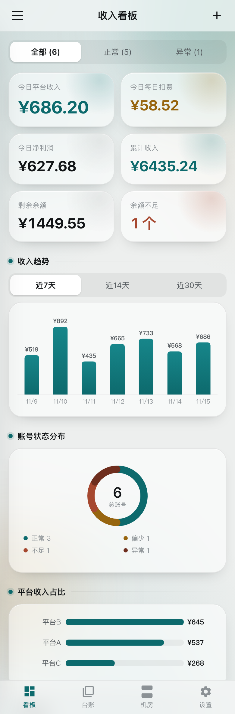
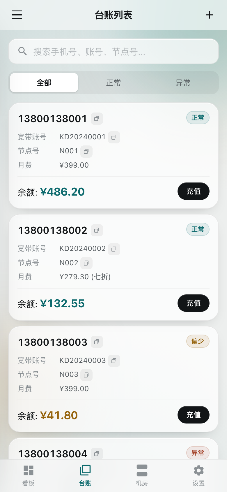
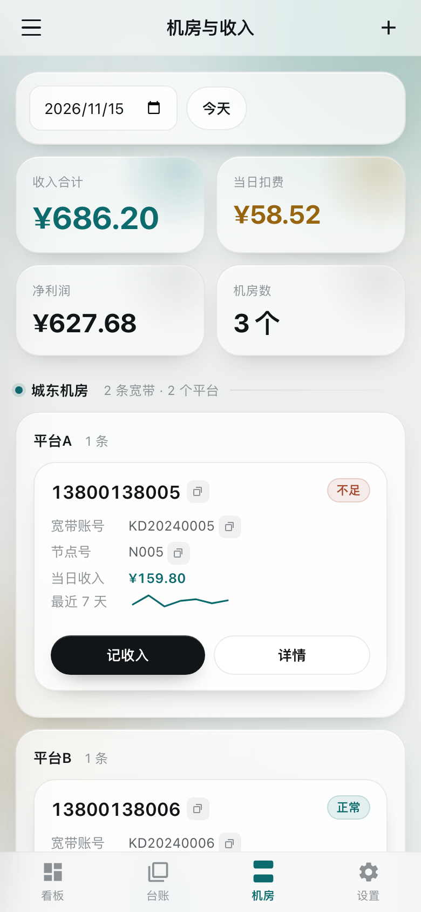
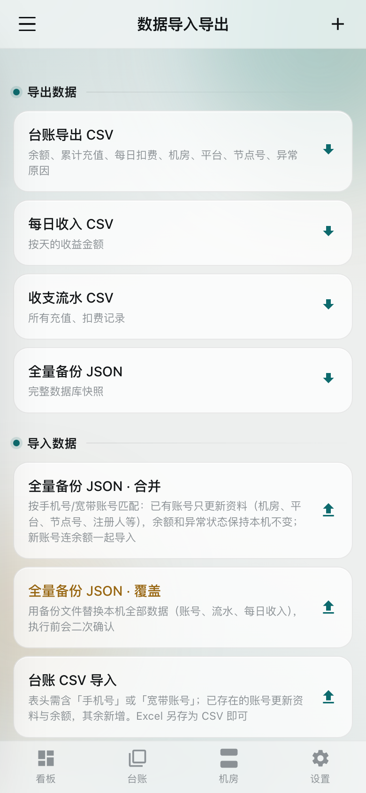
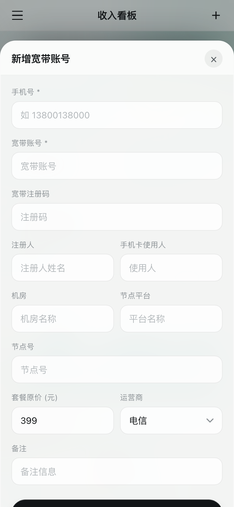
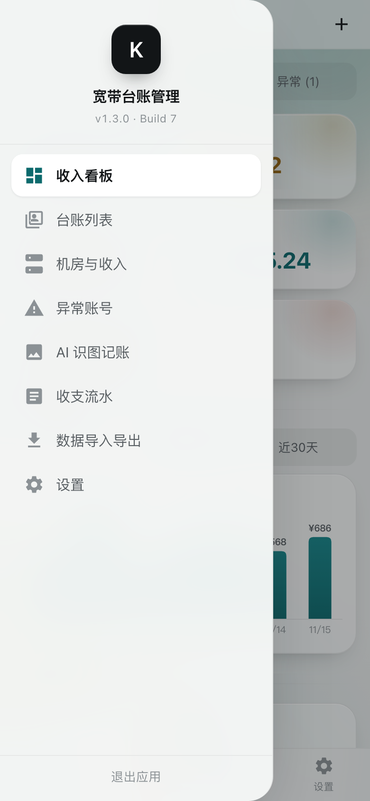
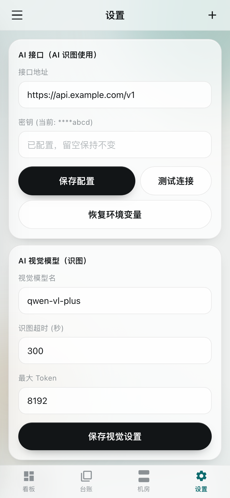

# kuandai-manager-android

**宽带账号台账 · 手机版 —— 装到手机上就能用，不用服务器、不用 Docker、断网也能记账。**

[](https://github.com/zozlio/kuandai-manager-android/actions/workflows/build-apk.yml)
[](https://github.com/zozlio/kuandai-manager-android/releases)


[](LICENSE)


给宽带代办点 / 运维人员用：把每个电话号码绑定的宽带账号、注册码、注册人、套餐费和剩余金额记在手机里，系统**每天按套餐自动扣一点余额**，余额不够就标红，还能传一张收益截图让 AI 帮你把账记上。

> 📱 这是 [zozlio/kuandai-manager](https://github.com/zozlio/kuandai-manager)（Web / Docker 版）的 **Android 手机版**。同一个项目、两种形态：
>
> | | 🖥 Web 版（Docker） | 📱 Android 版（本仓库） |
> |---|---|---|
> | 部署 | 一条 `docker compose up` | 装个 APK |
> | 数据 | 服务器 SQLite | 手机本机 localStorage |
> | 多人协作 | ✅ 局域网多人共用 | ❌ 一台手机一个人 |
> | 离线 | ❌ 要服务在线 | ✅ 断网照用 |
> | 上手门槛 | 要装 Docker | 装 APK 就行 |
> | 适合 | 机房 / 门店多人记账 | 跑单 / 装机师傅随身记 |
>
> **两边数据可以互导**：Android 版能直接导入 Web 版（FastAPI + SQLite）导出的全量备份，字段自动换算，v1.4.0 起开箱即用。

**当前版本 v1.4.1** ｜ 改动明细见 [CHANGELOG.md](CHANGELOG.md)

---

## 目录

- [功能一览](#功能一览)
- [下载安装](#下载安装)
- [界面预览](#界面预览)
- [数据存在哪 / 怎么备份](#数据存在哪--怎么备份)
- [导入 Web 版（Docker）备份](#导入-web-版docker备份)
- [AI 识图记账](#ai-识图记账)
- [每日自动扣费怎么算](#每日自动扣费怎么算)
- [目录结构](#目录结构)
- [本地开发与构建](#本地开发与构建)
- [界面与设计](#界面与设计)
- [常见问题](#常见问题)
- [与 Web 版功能对照](#与-web-版功能对照)
- [许可](#许可)

---

## 功能一览

| | 功能 | 说明 |
|---|---|---|
| 📇 | **宽带账号台账** | 手机号、宽带账号、注册码、注册人、卡使用人、机房、节点平台、节点号、运营商、套餐价、七折 |
| 💰 | **余额与累计充值** | 开号自动送 ¥500；充值带 +100 / +200 / +500 快捷键，余额实时回显 |
| 📅 | **每日自动扣费** | 每天按「月费 ÷ 当月天数」自动扣一点；余额不够就跳过，等充值了再继续，月末自动补齐余数 |
| 🧾 | **收支流水** | 充值 / 扣费 / 手动调整三态，每笔都有时间、描述、金额 |
| 🏢 | **机房与收入** | 机房 → 节点平台 → 账号三级分组，当日收入 + 最近 7 天迷你走势，可直接「记收入」 |
| 📈 | **收入看板** | 今日平台收入 / 今日扣费 / 今日净利润 / 累计收入 / 剩余余额 / 需催缴，7/14/30 天趋势图 |
| 🤖 | **AI 识图记账** | 传一张收益截图，AI 以**节点号**为主键识别，识别结果进可编辑确认表，人工确认后才写台账 |
| ⚠️ | **异常账号** | 6 种异常原因（机房 / 当前电费 / 管理线 / 限速 / 注销 / 欠费），可一键恢复正常 |
| 💾 | **导入导出** | 台账 CSV、每日收入 CSV、收支流水 CSV、全量 JSON 备份；**能直接吃 Web 版的全量备份** |
| 🔒 | **完全离线** | 数据只在本机 WebView 的 localStorage 里，不上传任何服务器 |

---

## 下载安装

1. 打开 **[Releases 页面](https://github.com/zozlio/kuandai-manager-android/releases)**，下载 `kuandai-manager_vX.Y.Z_日期_bN.apk`；
   也可以看 [Actions 构建记录](https://github.com/zozlio/kuandai-manager-android/actions) 里的同名 artifact。
   > ℹ️ APK 在本地的原名是 `宽带台账管理_vX.Y.Z_日期_bN.apk`；GitHub 的 Release 附件会把非 ASCII 字符归一化成 `_`，所以发布时另存了一份纯 ASCII 文件名。
2. 用手机浏览器下载后点击安装。首次安装系统会提示「未知来源应用」，按提示允许**当前这个浏览器**安装即可（不同 ROM 叫法略有差别）。
3. 装好打开就是用，无账号、无登录、无注册。

> 🔐 安装包是 **Debug 签名**（自用分发够用）；上架应用商店前需要用你自己的 keystore 出 Release 包，见 [本地开发与构建](#本地开发与构建)。

**要求**：Android 6.0（API 23）及以上，arm / arm64 / x86 通用。

---

## 界面预览

<p align="center">
  
  
  
  
</p>

<p align="center">
  
  
  
</p>

---

## 数据存在哪 / 怎么备份

- 数据存在 **App 内部 WebView 的 localStorage**（`kd_accounts` / `kd_transactions` / `kd_dailyIncome` 等键），**不联网、不上云**。
- 换手机、重装应用、清除应用数据 → **数据会没**。所以请定期在「侧边栏 → 数据导入导出 → 全量备份 JSON」导一份存着。
- 卸载前也记得先导备份。
- 备份文件含账号、余额和 AI 密钥等敏感信息，**别发到群里**。

---

## 导入 Web 版（Docker）备份

Web 版（FastAPI + SQLite）的备份是 `tables` 结构、snake_case 字段、整数外键，跟手机版的扁平结构对不上。**v1.4.0 起手机版会自动嗅探格式**，同一个导入入口直接吃下两种备份：

**侧边栏 → 数据导入导出 → 全量备份 JSON · 合并（或覆盖）→ 选 Web 版导出的 `.json`**

自动换算的内容：

| Web 版字段 | 手机版 | 备注 |
|---|---|---|
| `broadband_account` / `registration_code` | 宽带账号 / 注册码 | |
| `registrant` / `sim_user` | 注册人 / 卡使用人 | |
| `provider` | 运营商 | 中国电信 → 电信 |
| `abnormal_reason` + `abnormal_note` | 异常原因 + 备注 | machine_room → 机房、arrears → 欠费 … |
| `monthly_fee` + `discount_enabled` | 套餐原价 + 七折 | 容器版的 monthly_fee 是**套餐原价** |
| `daily_cost` = 0 | 每日扣费 | 按「月费 ÷ 当月天数」自动补 |
| `transactions.kind` = charge / recharge / adjust | 扣费 / 充值 / 调整 | 扣费记负数、充值记正数；「调整」的目标余额会按流水回放换算成**差额** |
| `daily_incomes.day` | 每日收入日期 | 机房 / 平台 / 节点从账号补齐 |

两个需要留意的点：

- ⚠️ **Web 版不记平台收入**（`daily_incomes` 通常是空的），所以导入后「今日平台收入 / 净利润」显示 0 是**如实反映**，不是导入失败。收入要么手工记，要么用 AI 识图补录——不会拿扣费流水冒充收入。
- 🔑 Web 版保存的 AI 接口配置会**顺手带过来**（地址、密钥、模型），但只补手机上的空缺，不会覆盖你已有的设置；服务端的会话密钥不会导入。

---

## AI 识图记账

「侧边栏 → AI 识图」→ 选一张收益平台截图 → AI 按**节点号**识别出每条账号和金额 → 识别结果进**可编辑确认表**（可改账号、改日期）→ 人工确认后才写入台账。

接口在「设置」里填，OpenAI 兼容格式，DeepSeek / 通义千问 / MiniMax / OpenAI / Ollama 都能用：

| 字段 | 说明 |
|---|---|
| 接口地址 | 如 `https://api.deepseek.com/v1` |
| 密钥 | 只显示尾 4 位，页面里不展示明文 |
| 文本模型 | 选填 |
| **视觉模型** | 识图必须配一个支持图像输入的模型（`gpt-4o`、`qwen-vl-plus` 等），纯文本模型不行 |

---

## 每日自动扣费怎么算

```
每日扣款额 = 月费 ÷ 当月天数
例：11 月 30 天，套餐 399 元 → 399 ÷ 30 ≈ ¥13.30/天
开了七折：399 × 0.7 = 279.30 → 279.30 ÷ 30 = ¥9.31/天
```

- 每天凌晨自动跑一次，`kd_lastDeductionDate` 防止重复扣；
- **余额不足不扣**，等充值后继续扣（不产生负数余额）；
- 月末补齐余数，整月加起来正好等于一个月费；
- 「设置」里可以改每天的巡检时间，也能在首页手动点「立即巡检」。

七折一旦打开就**永久锁定**（套餐价反复改会让历史流水对不上账）。

---

## 目录结构

```
kuandai-manager-android/
├── app/                              # Android 应用模块
│   └── src/main/
│       ├── AndroidManifest.xml
│       ├── java/com/kuandai/manager/ # Java 外壳：WebView + JS 桥接 + 文件选择器
│       │   ├── MainActivity.java
│       │   └── SplashActivity.java
│       ├── res/                      # 图标、主题、布局
│       └── assets/web/               # ★ 全部业务逻辑都在这
│           ├── index.html            #   单页应用入口
│           ├── style.css             #   「液面」视觉系统
│           └── app.js                #   约 2500 行，含容器版备份适配层
├── tools/
│   └── import-regression.js          # 导入回归测试（82 项断言）
├── .github/workflows/
│   └── build-apk.yml                 # CI：构建 APK + 发 Release
├── preview/                          # 界面截图与图标
├── AGENTS.md                         # 项目全貌与踩坑记录（给 AI 智能体看）
├── BUILD.md                          # 构建指南
├── build_config.json                 # 构建配置摘要
└── build.gradle / settings.gradle / gradle.properties / gradlew
```

**技术形态**：原生 Java 外壳 + WebView 加载 `assets/web` 里的单页应用，业务逻辑全在前端，数据用 localStorage 持久化。

- 兼容 Android 6.0+（minSdk 23），APK 约 6MB；
- 不用 Kotlin、不用 Jetpack 依赖臃肿，只留 AppCompat / Material / WebKit；
- 版本号单一真源在 `app/build.gradle`，原生层读 `BuildConfig`，网页层通过 JS 桥接读取，界面统一显示 `v1.4.1 · 2026.11.15 · Build 10`。

---

## 本地开发与构建

**环境要求**

| 组件 | 版本 |
|---|---|
| JDK | 17 |
| Android SDK | API 36（Android 16）+ Build Tools 36.0.0 |
| Gradle | 9.6.0（wrapper 自动下载） |
| Android Gradle Plugin | 9.5.0 |

```bash
# macOS
brew install openjdk@17
export JAVA_HOME="$(brew --prefix openjdk@17)/libexec/openjdk.jdk/Contents/Home"
brew install --cask android-commandlinetools
export ANDROID_HOME=$HOME/Library/Android/sdk
sdkmanager --licenses
sdkmanager "platforms;android-36" "build-tools;36.0.0"
```

**构建**

```bash
git clone https://github.com/zozlio/kuandai-manager-android.git
cd kuandai-manager-android
chmod +x gradlew          # 若报 Permission denied 就补这一行
./gradlew assembleDebug
# 产物：app/build/outputs/apk/debug/宽带台账管理_v1.4.1_20261115_b10.apk
```

**出正式签名的 Release 包**

```bash
keytool -genkey -v -keystore kuandai.keystore -alias kuandai -keyalg RSA -keysize 2048 -validity 10000
./gradlew assembleRelease
# 产物：app/build/outputs/apk/release/宽带台账管理_v1.4.1_20261115_b10.apk
```

> ⚠️ keystore 和 `local.properties` 已在 `.gitignore` 里，**别提交**。

**改前端后本地预览**：`file://` 下 localStorage 会被禁用，需要起个本地服务：

```bash
cd app/src/main/assets/web && python3 -m http.server 8080 --bind 127.0.0.1
# 浏览器打开 http://127.0.0.1:8080/index.html
```

**导入逻辑回归测试**：`tools/import-regression.js` 跑 82 项断言（账号数、余额合计、字段映射、扣费负号、调整差额换算、合并幂等等），用法见文件头注释。

---

## 界面与设计

视觉系统叫 **「液面 / Liquid Ledger」**：这个业务本质是「光纤线路」的账，所以信号色用光纤青而不是苹果蓝；基底是冷调纸白 + 机房窗光，材质是磨砂玻璃。

| 角色 | 色值 | 含义 |
|---|---|---|
| 基底 | `#EDEFEE` | 冷调纸白 |
| 主文字 | `#121517` | 墨黑 |
| 次级文字 | `#575D61` | |
| 信号色 | `#0D6A6D` | 收入 / 正常（光纤青） |
| 暖告警 | `#97650F` | 扣费 / 余额偏少（琥珀） |
| 危险 | `#A6482F` | 欠费 / 异常（锈红） |

网页层、原生主题、启动图标三处配色同步；金额和编码统一 `tabular-nums`，小数点钉在同一列。启动图标是「数据仪表」：纸白底 + 淡网格 + 液面渐变 + 收入曲线 + 峰值发光节点，按 Android 自适应图标规范（108dp 画布 / 72dp 安全区）绘制，另附 Android 13 主题图标单色剪影。

---

## 常见问题

**Q：装完打开是空白页？**
A：极少见，多半是 WebView 被系统精简（部分国产 ROM 的「省电/无障碍」优化会杀 WebView）。在系统设置里把本 App 的电池优化关掉即可。

**Q：数据会传到服务器吗？**
A：不会。App 只在加载本地 `assets/web` 资源时用到网络权限；台账数据全程在 localStorage。唯一会主动联网的是你主动配了 AI 接口并使用识图功能时。

**Q：能多台手机一起用吗？**
A：不能，这是单机版。要多人协作请用 [Web 版](https://github.com/zozlio/kuandai-manager)。

**Q：怎么把 Web 版的数据搬过来？**
A：见上面 [导入 Web 版（Docker）备份](#导入-web-版docker备份)。Web 版导出「全量备份 JSON」，手机版导入选「合并」即可；本机已有同手机号账号时，以本机余额为准，只补资料字段。

**Q：卸载重装后数据还在吗？**
A：不在。localStorage 随 App 数据一起被清掉，**卸载前务必导出备份**。

**Q：怎么提 bug / 要功能？**
A：开 [Issues](https://github.com/zozlio/kuandai-manager-android/issues) 提，别带敏感信息。

---

## 与 Web 版功能对照

| Web 版功能 | Android 版 |
|---|---|
| 台账 CRUD | ✅ |
| 开号送 ¥500 | ✅ |
| 充值 + 快捷按钮 | ✅ |
| 七折开关（锁定） | ✅ |
| 按天扣费 + 月末补齐 | ✅ |
| 正常 / 异常分类（6 种原因） | ✅ |
| 机房 / 平台 / 节点号 | ✅ |
| 机房与收入页（三级分组 + 7 天走势） | ✅ |
| 记收入（upsert 同日覆盖） | ✅ |
| 手动记一笔（充值 / 扣费 / 调整） | ✅ |
| 删除账号 | ✅ |
| 收入看板 + 趋势图 | ✅ |
| AI 识图记账 | ✅ |
| 数据导出（CSV + JSON） | ✅ |
| 数据导入（JSON 合并 / 覆盖 / CSV / **Web 版备份**） | ✅ |
| 一键复制 | ✅ |
| 催缴提醒 | ❌ 手机版按「余额不足」红标代替，不做主动提醒 |
| AI 问答助手 | ❌ 手机版只保留识图 |
| 登录注册 / 多人协作 | ❌ 单机离线 |

---

## 许可

[MIT](LICENSE) © 2026 zozlio

本项目是 [kuandai-manager](https://github.com/zozlio/kuandai-manager) 的 Android 版本，同属 MIT 许可。
